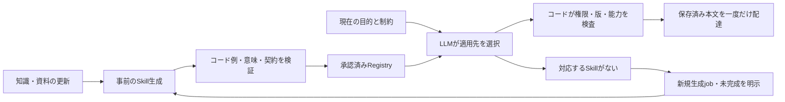

# SkillSmithの再評価と2〜3秒を目指す設計

対象は`d0952b661ba8ee0599bf8dc187684235b4381799`。2026年11月8日時点のコア、SQLite、検証用ホスト、配布契約を評価した。**技術品質は63.7/100、2〜3秒の要件は未達**。将来性の正式点は、実作業の比較優位・本体導入・継続利用の証拠が不足するため保留する。

**推奨する方向は、依頼のたびに長いSKILLを書き直す処理から、事前に生成・検証したSKILLをLLMが選び、現在のタスクへ結び付ける処理への変更である。** 利用時に必要な出力を参照IDと適用判断へ絞り、元の本文とコード例は保存済みのものを読む。既存のRegistry、Repository、権限、版検査、job機構を再利用する。

完全に未知の内容を含む詳細SKILLを初回から3秒で生成できるという証拠は、現時点ではない。この要求を「候補がなければ3秒でpendingを返す」へ置き換えない。事前生成による再利用と、真の新規生成の達成率を分けて測定する。

## 評価の範囲と結論

前回と同じrubric 1.1.0・library profileを固定し、30項目を0〜4の基準で採点した。SDKと検証環境についての評価済み比重は100%、判断の確信度はMedium、除外した観点の重みは0%。本体への実導入を確認した点数ではない。重大度Highは2件、Mediumは2件、Lowは1件。既存のCIは変更対象外とし、採点上は基本水準を維持した。

以前の74.7点とは、求める待ち時間と新しく得られた証拠が異なる。今回の点数差を、そのままコードの品質が悪化した割合とは解釈しない。生成物の平均96.7点も、処理速度・配達成功率・プロジェクトの技術品質とは別の値である。

| 技術観点 | 重み | 現在/10 | 根拠と限界 |
| --- | ---: | ---: | --- |
| 設計・責務 | 12% | 5.8 | portとtransactionの分離は明確。毎回の詳細生成は3秒の利用条件に合わない |
| 正確性 | 20% | 7.5 | schema・版・epoch・状態遷移の正常/負例を検証。全体の配達と意味的な正しさは別に判定が必要 |
| 権限・安全性 | 10% | 7.5 | principal/scope/epoch/操作/実行の境界を検証。本体の認証wrapperは別受入 |
| 失敗・復旧 | 8% | 5.8 | 予約保持、CAS、rollback、クラッシュ復旧がある。容量超過時は保存済み本文があっても通常配達できない |
| 保守性 | 12% | 5.8 | 主要処理は追跡可能。長い指示・複数の文書表現・評価入口の変更負担が残る |
| 共通機構 | 5% | 6.7 | 共通ホスト・schema・rendererを再利用。公開応答には内部表現と本文の重複がある |
| テスト | 15% | 6.7 | 固定試験532件と違反注入、再生が機能。LLM採点の誤帰属、実負荷・本体での時間計測は残る |
| 依存・配布 | 10% | 6.7 | 固定依存、改変検出、配布物consumer。現時点のauditは報告0件、正式配布の運用は未実証 |
| 時間・資源 | 5% | 2.5 | 初回3件すべて3秒超。同一依頼の再利用はローカルで速いが、意味の近い別表現への再利用は未成立 |
| 利用・運用 | 3% | 4.2 | 状態と計測は残る。新規3件の通常配達成功は1件、本体Registry接続は未確認 |

技術点の計算上の範囲は63.7〜63.7点。これは全評価項目に値を付けた結果であり、統計的な信頼区間やリリース認証ではない。本番利用には条件付きの状態と判定した。

将来性の評価済み比重は63.3%。比較優位の必須観点が未確定なので、全体点も暫定点も付けていない。未評価項目の算術上の範囲23.8〜60.4点は、将来の成長予測ではない。

| 将来性の観点 | 現時点の判断 |
| --- | --- |
| 課題の価値 | 速く使える実行知識が欲しいという内部利用者の要求は明確 |
| 解決手段の適合 | 現方式は待ち時間と配達容量の両方で不足 |
| 差別化 | 版・権限・失効・利用結果を結ぶ仕組みは有用だが、既存方式より実作業を良くする比較は未成立 |
| 新規性 | 検索、Skill化、振り返りの組合せだけで独自性や効果を高く評価しない |
| 導入・継続利用 | 本体への導入負担、利用の定着、実作業の改善は未測定 |
| 継続資産 | 型付き契約、保存・失効機構、検証可能な成果物は維持すべき資産 |
| 実行力 | 修正と追跡可能な検証は進んだが、速く安定して使える段階には届いていない |
| 導入時期・体制 | 利用者の需要と利用可能な技術はある。実接続と継続資源の判断が必要 |
| 拡張性 | 別題材でも本文は作れるが、応答容量の問題が新たに露見した |

## 58.74秒の内訳

新規3シナリオの実測平均。失敗2件も除外していない。

| 処理 | 平均 | 全時間に占める比率 |
| --- | ---: | ---: |
| 検索文のLLM言い換え | 1.34秒 | 2.3% |
| 読む資料を決めるLLM呼出し | 2.43秒 | 4.1% |
| 本文・参照コード・管理情報の生成 | **47.57秒** | **81.0%** |
| 生成後の意味レビュー | 7.31秒 | 12.4% |
| ローカル処理・その他 | 0.09秒 | 0.2% |
| **合計** | **58.74秒** | **100%** |

API時間は推論、提供側の待機、送受信を含む。GPUの純粋な計算時間や最初のトークンまでの時間を測った値ではない。対象3件を母集団のp95とも呼ばない。

現在の生成APIは平均約3,819出力トークン、実効約80トークン/秒。全体を3秒へ縮めるには約19.6倍、2秒なら約29.4倍が必要である。同じ本文生成を残したまま他をすべて消しても、観測上の本文生成47.57秒が残る。出力を半分にしても約23.8秒という単純試算であり、それだけで目標に届く根拠にはならない。

[OpenAI公式の遅延最適化](https://developers.openai.com/api/docs/guides/latency-optimization)も、出力トークンと呼出し数の削減を主要な手段としている。ただし、本件の達成秒数は公式資料から保証されるものではない。

## 追加確認で分かった再利用の境界

現行コードを変更せず、配達に成功したAsciiDocの同一依頼を200回再利用した。初期化は保存済み応答の再生、準備10回を除く測定では追加LLM呼出し0、配達200/200、中央値1.53ミリ秒、p95は2.72ミリ秒だった。毎回2件の資料版確認を含むが、ローカルの公開fixture内での処理である。実サービスでの通信や親Agentの判断時間を含む実績ではない。

一方、同じ目的の「計画を作ってください」を「計画を提案してください」へ変えると、キャッシュは使われず、生成jobが登録された。現行キーは目的文、受入条件、環境、各上限、主体・scope・epoch・出典、指示版を含む。安全な同条件キャッシュとしては正しいが、意味の近い新しい依頼へ完成品を選び直す機構ではない。

検証用ホストは毎回メモリDBを作り直し、Registryの検索も空である。今回の約59秒は、正式SKILLが蓄積した運用環境の再利用速度を測っていなかった。ここは性能の評価条件として修正する必要がある。

目的やprincipalを既存キャッシュキーから削って命中率を上げてはいけない。別タスク・別権限へ誤った本文を返す危険がある。意味的な適用判断をLLMに残し、既存の厳密なキャッシュと正式Skillの検索・選択を別の契約として実装する。

## 検証済みの主な問題

| ID | 優先度 | 問題と結果 | 対応 |
| --- | --- | --- | --- |
| F01 | P0・High | 新規依頼で長文とコード例を直列生成し、3秒以内のreadyが0/3 | 利用時の取得・適用判断と、事前生成・検証を分離 |
| F02 | P0・High | 内部BuildとSkillを重ねた最終JSONが32KBを超え、通常配達1/3 | 公開応答を最小化し、監査情報を別参照へ |
| F03 | P1・Medium | 厳密キャッシュの一致範囲と正式Registry未接続により、言い換えでも再生成 | 安定したSkillとタスク固有情報を分離し、LLMによる適用選択を追加 |
| F04 | P1・Medium | 内容点は高くても、採点が本文にない記述を読み込み、配達・速度も評価しない | 原文照合と、ready・時間・権限・版の必須判定を併用 |
| F05 | P2・Low | 文字種等で追加される検索文の推論が平均1.34秒 | 親LLMの公開検索文、または索引側の多言語対応を検証 |

反証も確認した。全処理が遅いわけではなく、既存の同条件キャッシュは速い。容量ガードは誤っているのではなく、重複した応答に対して正しく拒否している。短縮指示の別試行はreadyが6/20に留まり、改善として採用されなかった。単純な「短く書く」指示やガード解除で解決済みとはしない。

## 推奨する構成

### 1 利用時に必要な意味判断を小さくする

親Agentが候補のname、description、適用条件、版を読み、利用するSkillと必要な結付けを選ぶ。単体利用で選択LLMが必要な場合も、出力は参照IDと短い適用判断へ絞る。業務判断を文字列辞書、正規表現、類似度の閾値による自動採用へ移さない。検索順位は候補作成に使い、適用の保証にはしない。

LLMが毎回3,800トークンを書く経路を、通常は0トークンの本文生成と、必要時だけ100〜200トークン程度の選択出力へ変える設計候補である。後者の量・時間・品質はまだ未測定。参照IDを返した時点で完了とせず、必要な本文を取得し、版・権限の検査を通ったところまで測る。

### 2 安定したSkillと現在のタスクを分ける

| 保存対象 | 内容 | 更新する時期 |
| --- | --- | --- |
| Skill本体 | 適用条件、手順、安全条件、reference、コード例、本文digest | 知識や実装・方針の版が変わったとき |
| タスクへの結付け | 今回の目的、対象、reader制約、環境、主体・epoch、許可範囲 | 依頼ごと |
| 監査情報 | 採用資料の版、生成・レビューの証跡、利用・失敗報告 | 生成・利用・検証の各段階 |

現在の「今回行うのは計画文書だけ」といった制約は、その依頼の文脈として保持する。別の依頼で本文を流用する際、計画限定を実操作の許可へ昇格させない。タスク条件の確認はLLM、実際の権限・scope・失効の強制はコードが担う。

共有するのは公開承認済みのSkill版であり、別principalのBuildやrequestをキャッシュのまま返すのではない。利用者ごとにタスクとexecutionへの結付けを作り、公開の承認根拠と参照資料のscopeを検査する。既存の元所有者に結び付くBuildの認可を緩めて共有を実現しない。

生成と検証は既存のjob、prepare/reserve/execute/settle、候補管理、利用結果の機構を使う。新しいAgent frameworkや別の権限管理を足す必要はない。資料の更新で依存Skillを失効させ、承認された新しい版ができるまで旧版をreadyとして返さない。

### 3 公開応答から内部表現の重複を除く

互換性のため既存`get`系は保持し、版を明示した公開配達契約を追加する。公開側には本文とreferenceのbundle、digest、結付けと監査への参照、必要最小限の版情報を返す。内部Build、同じ手順の別表現、元資料本文を再掲しない。詳細監査の取得にも同じ主体・scope・操作権限を検査する。

凍結済みの実物を使った仮の応答サイズは11,514／9,843／11,799バイトで、いずれも32KB以内だった。これはサイズの設計計算であり、新APIの正しさや配達成功を実証したものではない。元の失敗結果は変更しない。

既存の生成内容も、一つの正本表現からMarkdown、監査用の索引、配達データを導出する。LLMに同じ手順を複数フィールドへ書かせない。原条件の意味、必須コード例、停止条件、意味レビューは残し、重複を除く。

### 4 版確認も取得経路として設計する

現fixtureの`SourcePort.validate`は、資料を一件ずつ全文取得して版を確かめる。実サービスでもこの方法なら、外部通信が速い経路の制約になる。既存のRegistry/Source portを使い、所有domainの公開APIで版の一括確認、変更通知、またはそれに相当する信頼できる現在性を得る。

ローカルの権限・方針・版索引が現在性を保証できるなら取得時の判定に使う。保証できなければ外部確認を行い、間に合わないときに古い本文を返さない。本体の既存公開APIを先に照合し、不足がある場合に所有domainへ追加する。現時点の実ホストAPIの有無や往復時間は未確認である。

### 5 完全新規の生成は別途高速化を試す

初めて必要になった長文・新しいコード例を含むSkillは、現状では約60秒の生成経路になる。これも初回から3秒以内にするなら、単一の正本出力、短い入出力、独立工程の並列化、高速な推論環境を組み合わせて実測する必要がある。完成前の返却、コード例の削除、意味レビューの無条件省略を達成扱いしない。

高速推論の候補はある。[Groqの公式モデル表](https://console.groq.com/docs/models)にはGPT-OSS 120Bが500、20Bが1,000トークン/秒と掲載されている。ただし提供側の数値であり、本件の日本語・構造化出力・入力長・レビューを含む測定ではない。モデル間のtokenizerも異なる。同じ3,819トークンを1,000/秒と仮置きしても出力だけで約3.8秒となるため、モデル交換だけで達成する前提を置かない。

[Cerebrasの予約容量](https://inference-docs.cerebras.ai/dedicated/overview)も選択肢だが、企業向け契約と構成ごとの検証が必要である。現在の接続で利用できるモデル、互換性、費用、品質を確認してから候補にする。今回は接続変更・契約・有料比較を行っていない。

## 2〜3秒という目標の測り方

主指標はSkillSmithの受付から、タスクに適用できる本文を利用側が取得し、権限・版の検査を終えるまでの時間とする。選択のためにサービスが追加するLLM呼出し、取得、配達を含める。アプリ側で親Agentが選ぶ場合は、その時間も別に計測し、SDK時間だけで利用者の体感目標を達成したとは報告しない。

| 経路 | 目標 | 現時点の根拠 |
| --- | --- | --- |
| 指定された承認済みSkillの取得 | p95で1秒以内を目指し、全体3秒の余裕を確保 | 同条件のローカル再利用は速い。実ホストは未測定 |
| 意味の近い依頼からの選択・取得 | 利用可能なreadyまでp95で3秒以内 | 新たな適用選択・本体接続・品質計測が必要 |
| 真に新しい詳細Skillの完成 | 同じく3秒を目標とするなら独立して検証 | 現行3件はすべて未達。事前生成で解消したとは数えない |
| 候補不足・確認不足・権限拒否 | 状態と理由を期限内に返す | 速い失敗やpendingは、速いreadyの成功数へ含めない |

取得が速いだけでは全要求のp95を満たせない。例として、適用可能な完成品の比率をH、その経路で正しく3秒以内に返る率をPfast、新規生成での同率をPcoldとすると、全体の率は`H×Pfast+(1−H)×Pcold`となる。Pfast=99%、Pcold=0を仮定して95%を目指すならHは約96%必要になる。この比率は未測定で、実際の目標値は利用分布から決める。

最初は頻出の許可された用途へ絞り、命中しない要求も含む分布で評価する。6,957件の知識を一括でSkill化する計画や、何でも安全に適用できる一つのSkillは前提にしない。

## 実施順と受入条件

| 段階 | 作業 | 主な変更場所・依存 | 合格条件 | 規模の根拠 |
| --- | --- | --- | --- | --- |
| P0 | 公開配達の小さい契約と一つの正本文書 | `schema.ts`、`skill-markdown.ts`、`index.ts`、既存consumer | 凍結3件が32KB内で配達可能。旧APIは互換。改変・部分bundle・失効・越権は従来どおり拒否 | M：schema、renderer、配達、利用側を横断 |
| P1 | 承認済みSkillの永続登録とタスク結付け | Registry/Repository、既存候補・公開・忘却の所有境界 | 言い換え・別依頼で適用可能なSkillを選べる。異なる権限・条件を類似度だけで流用しない | L：本体の公開API・現在性・失効契約の照合を含む |
| P1 | 利用時の短いLLM選択と取得 | 親Agentのtool契約、または一回の小さい選択推論 | 本文の再生成0。取得・版・権限・選択を含む実時間を記録し、ready p95≤3秒を満たす | M：既存推論portは再利用。出力契約と評価を追加 |
| P1 | 生成・意味レビューを登録と更新へ移す | 既存jobs、生成器、候補承認、依存リンク | 再生成中の旧版を誤配達しない。承認前の出力を公開しない。クラッシュ後も一貫して再開 | M：既存の状態管理を使い、配置する段階を変更 |
| P2 | 完全新規向けの小さい正本出力・高速モデル比較 | 生成指示/schema、provider adapter、検証用資料 | 未使用課題で品質・誤API・停止条件・全処理時間を確認。3秒に届かなければ未達と記録 | L：モデル互換と品質の不確定性が大きい |
| P2 | 検索文の補助推論と版確認の往復を減らす | query adapter、索引、Source.validate、所有domainの公開API | 多言語・言い換えで選択品質を落とさず、内部文脈を外部queryへ混ぜない | M：小さなコード変更でも検索品質・外部契約を照合 |

規模S/M/Lは変更境界と不確定性を表す。未確認の人員や日数を見積りに置いていない。P0〜P1で速い取得を確立しつつ、完全新規3秒の可否を独立した検証として残す。

受入の共通条件は次のとおり。

1. **速度と完了を一緒に測る。** 再利用成功、適用選択、新規生成、pending、失敗、取消しを別集計し、失敗や遅い要求を除いてp95を作らない。段階ごとのp95の合計で全体p95を代用しない。
2. **品質を落とさない。** 原条件、禁止範囲、具体的手順、reference、誤API、未確認事項の扱いを本文と照合する。高いLLM点数だけを合格条件にしない。
3. **安全な再利用を守る。** principal/scope/epoch、現在のpolicy、必要能力、資料版、失効、忘却、利用先executionを、速い取得経路でも検査する。sourceが不明・変更済みならreadyへ変換しない。
4. **過学習を避ける。** 既存20件と新規3件は開発用へ固定する。別題材・別参照元・別表現の課題を、変更後に同じ条件で評価し、失敗を含む全試行を残す。新しい結果を見て調整した試行は最終未使用testと呼ばない。
5. **実ホストで確かめる。** 空Registry、メモリDB、ローカル資料だけの時間と、実際の取得・版照合・並行利用の時間を分ける。既存532件を保ち、新しい配達・再利用・失効の結合を追加する。CIの追加は今回の計画に含めない。

## 維持する資産と比較した選択肢

コアの権限、CAS、予算予約、利用結果の結付け、失効、クラッシュ復旧、配布物検査は残す。速度を理由にこれらを外す必要はない。価値の中心は、毎回文章を作ることから、**検証済みの実行知識を適切な版・権限・文脈で供給すること**へ移す案である。

| 選択肢 | 利点 | 本件で残る課題 |
| --- | --- | --- |
| [Agent Skillsの保存済み文書](https://agentskills.io/specification) | metadata→本文→必要なresourceという段階取得。毎回全文を生成する必要がない | 権限・版・失効・適用判断は利用側の実装と照合が必要。仕様が個々の製品の非対応を意味するわけではない |
| [LangGraphのStoreと背景更新](https://docs.langchain.com/oss/javascript/langgraph/memory) | 依頼中の更新と背景更新を分け、名前空間を持つ情報を検索・取得できる | framework導入だけで本件のartifact品質・権限・3秒を保証しない。既存portで足りる範囲は置換しない |
| ContextStillから親Agentが直接読む既存baseline | 中間の長文Skill生成を省ける比較対象 | 同等の作業成功・安全性・費用の比較が未成立。過去の180回答の疑わしい合否は優位性の根拠に使わない |
| 現行compactモード | 既存の明示的な実験経路を使える | 共通の長文表示・コード例・意味レビューは残る。切替だけで3秒になる実績はない |
| 高速推論サービス | 生成速度を改善できる可能性 | 本件の入出力、構造化schema、日本語、品質、TTFT、提供条件は要測定。契約や料金を未確認のまま採用しない |

## 検証と根拠

対象commitの隔離worktreeでBun1.4.4/macOS arm64の標準verifyを実行し、532 pass、型155、lint・format・build・packが成功した。固定済み依存を再利用しており、新規installの試験ではない。`bun audit --json`はexit0、結果`{}`。未知の脆弱性ゼロを意味しない。

今回の追加検証は、ローカルの同条件キャッシュ200回と一つの言い換え、既存の実測値からの計算、公開資料の確認である。新しい有料LLM呼出し0、累計予算計上13.4743594/15 USD、未確定予約4.528887 USDは保持した。元の実装は変更していない。同一担当が反証確認も行い、独立した人手レビューとはしていない。

- [根拠・全60評価項目・指摘](review.json)／[公式計算結果](score-summary.json)
- [時間内訳と単純試算](latency-analysis.json)／[計算用スクリプト](derive-latency.py)
- [同条件キャッシュの実測と範囲](cache-probe.json)／[再現用probe](probe-cache.mjs)
- [仮の配達契約のサイズ計算](delivery-size-design.json)
- [隔離検証の条件・source hash](verification.json)／[verify記録](verify.log)／[audit記録](audit.log)

今回の設計案を実装しても、未測定の項目へ点数を加算しない。3秒で使えるという要件、実ホストの適合、品質と安全性が確認できたsnapshotで改めて採点する。
